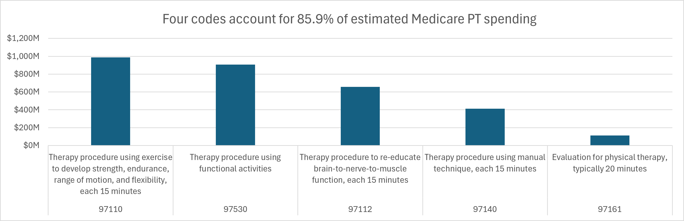
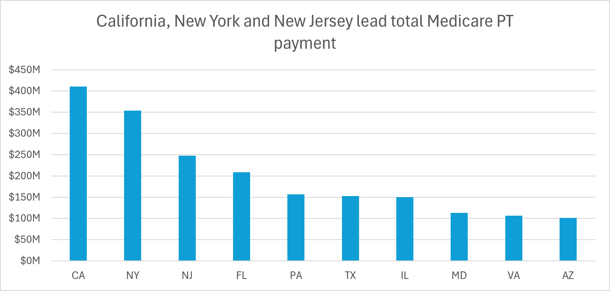
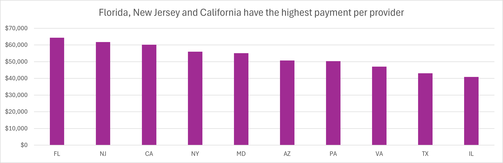
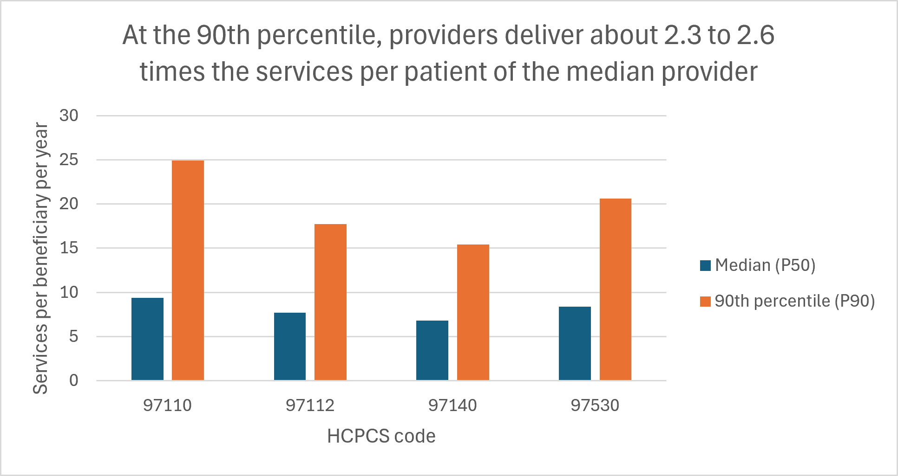
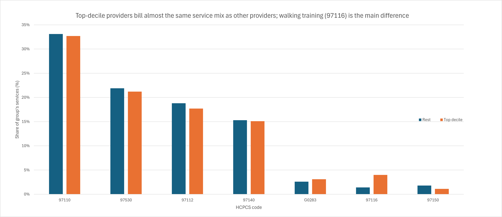
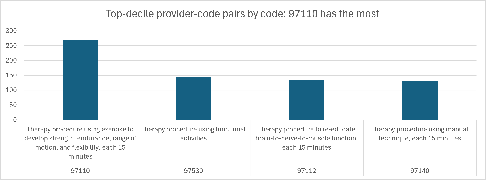

# Medicare Outpatient Physical Therapy: Where the Money Goes and How Much Provider Intensity Varies

*A payer or multi-site PT group can use this analysis to decide where to benchmark first: four billing codes carry most of the spend, and intensity per patient varies about 2.3 to 2.6x between the median and the 90th-percentile provider.*

> **Portfolio project, public data only.** Built by a physical therapist moving into healthcare analytics. Tools: Python (filtering and loading to MySQL), MySQL 8, Excel.
> Estimated payment is `services x average Medicare payment`. It is an estimate, not the actual amount paid.

---

## Business question

Where does Medicare Fee-for-Service spend its outpatient physical therapy (PT) money, and how much do providers differ in how many services they deliver per patient? Which codes, states and providers deserve a closer look first?

## Data

| Item | Detail |
| --- | --- |
| Source | CMS, *Medicare Physician & Other Practitioners - by Provider and Service* (data.cms.gov). Medicare Fee-for-Service claims, one row per provider, HCPCS code and place of service. |
| Year | Data year 2024 (CMS release folder `2024`); file `PHY_R26_P05_V10_D24_Prov_Svc` |
| Filter | Provider type = "Physical Therapist in Private Practice". The 3 GB file was filtered in chunks with Python (`python/01_filter_and_load.ipynb`) and saved as `pt_only.csv`, then loaded into MySQL as `healthcare_db.pt_raw`. |
| Size | 408,753 rows, 77,296 distinct providers, 60 distinct state codes (states, DC, territories, military and unknown codes), 121 HCPCS codes |

**Known problems and what I did about them** (from `sql/pt_medicare_analysis.sql`, section Q0):

| Issue | Finding | Decision | Status |
| --- | --- | --- | --- |
| NULLs in numeric columns | None found (0b) | No action | Confirmed in SQL |
| Zero or negative average payment | 5 rows (0c) | Excluded in the `pt_clean` view (`Avg_Mdcr_Pymt_Amt > 0`) | Confirmed in SQL |
| Duplicate provider + code + place rows | None found (0d) | No action | Confirmed in SQL |
| Non-state values in the state column | Military postal codes (AA, AE, AP) and unknown codes (XX, ZZ) appear. Territories and DC were kept as valid CMS regions. | Noted in a SQL comment. The `pt_clean` view does **not** filter them. None of them appear in the top-10 state results. | To verify for other outputs |
| Codes that are not traditional PT | The filter was by provider type, not by a code list, so skin procedures, strapping and similar codes are present (0e) | Kept in spend totals. Charts show only the top codes. | Confirmed in SQL |
| Small provider volumes | Services per beneficiary is unstable with few patients | Intensity analysis keeps only providers with at least 20 beneficiaries on a code (`pt_intensity` view) | Confirmed in SQL |
| Mixed settings | Office (`O`) and facility (`F`) rows are not comparable | Intensity and mix analysis use office rows only | Confirmed in SQL |

**Metric definitions**

| Metric | Definition |
| --- | --- |
| Estimated payment | `Tot_Srvcs x Avg_Mdcr_Pymt_Amt` |
| Services per beneficiary | `Tot_Srvcs / Tot_Benes` for one provider and one code (a yearly figure, not per visit) |
| Top decile | Providers in the top 10% of services per beneficiary within the same state and code, ranked only where a state-code group has at least 10 providers (`NTILE(10)` in `pt_ranked_tbl`) |
| P50 and P90 | Median and 90th percentile of services per beneficiary across all office providers on a code. MySQL has no `PERCENTILE_CONT`, so they are picked with `ROW_NUMBER` and `CEIL`. |

## Approach

**SQL (MySQL 8), in `sql/pt_medicare_analysis.sql`**

1. **Profile and clean (Q0):** row counts, NULLs, bad values, duplicates, code list, then the `pt_clean` view.
2. **Spend by code (Q1):** `GROUP BY` code, share of total with a subquery, cumulative share with a window function (`SUM() OVER (ORDER BY ...)`).
3. **Office versus facility (Q2) and states (Q3):** estimated payment, payment per service and payment per provider (`COUNT(DISTINCT npi)`).
4. **Intensity (Q4):** `pt_intensity` view, services per beneficiary with `NULLIF` to avoid division by zero.
5. **Ranking inside state and code (Q5):** `PERCENT_RANK()` and `NTILE(10)` with `PARTITION BY state, code`. The result is materialised as `pt_ranked_tbl` because the stacked views were too slow in MySQL Workbench.
6. **Top decile versus the rest (Q6):** service mix per group with CTEs and `CASE WHEN`, and P50 and P90 per code.

**Excel (`excel/pt_utilization_summary.xlsx`)**

The SQL result sets were exported as CSV and imported into Excel. Pivot tables and charts were built from them: spend by code, top states, top-decile providers, code mix and intensity.

## Key findings

### 1. Four codes carry 85.9% of estimated spend

Therapeutic exercise (97110), functional activities (97530), neuromuscular re-education (97112) and manual therapy (97140) together account for **85.9%** of estimated Medicare PT payment. They total about **$2.96 billion**: 97110 $987.8M, 97530 $906.8M, 97112 $657.0M and 97140 $411.4M. The 80% line is crossed at the fourth code. The total across all codes is **$3.45 billion** ($3,450,700,178).



### 2. The biggest states are not the highest-paying per provider

California leads total estimated payment at **$410.4M**, followed by New York ($354.0M), New Jersey ($247.4M) and Florida ($208.7M). The ten largest states total $2.00 billion. Ranked per provider, Florida comes first at **$64,322**, then New Jersey ($61,815) and California ($60,208). Illinois ranks seventh by total but last of the ten per provider ($40,912), and Texas drops from sixth to ninth. Provider counts per state (column `providers` in Q3) would show how much of this is about how many providers a state has.




### 3. Providers differ widely in intensity, but not in what they bill

At the 90th percentile, a provider delivers **about 2.3 to 2.6 times** the services per beneficiary of the median provider. The median and P90 per beneficiary per year are: 97110 9.4 and 24.9, 97530 8.4 and 20.6, 97112 7.7 and 17.7, 97140 6.8 and 15.4.

Top-decile providers bill almost the same mix as everyone else. The four core codes are **86.7%** of their services versus **89.1%** for the rest. The clearest gap is walking training (97116) at 4.0% versus 1.4%. Group therapy (97150) goes the other way at 1.1% versus 1.8%. The evaluation codes are also a smaller share of their services (97161 at 0.6% versus 1.1%, 97162 at 0.6% versus 0.9%).




The top-decile file lists provider-code pairs: 269 for 97110, 144 for 97530, 135 for 97112 and 132 for 97140. A provider can appear once per code. These are counts of provider-code pairs, not of providers, so they should not be read as the number of high-intensity providers.



## Recommendations

1. **Benchmark first on intensity, not on code mix.** Mix is nearly the same in both groups, so intensity (services per beneficiary) is where the variation is. Start with providers above the state P90 on 97110, 97530, 97112 or 97140.
2. **Check context before drawing conclusions.** Review patient complexity and documentation for high-intensity providers. Walking training (97116) is the one code that stands out in the mix comparison; this analysis cannot explain why.
3. **Read state totals together with provider counts.** Use payment per provider, not total payment, when comparing states. Add providers per state to the chart before using it for any resourcing decision.

## Limitations and what I would do next

- **Claims, not outcomes.** There are no patient outcomes, so high intensity cannot be judged as good or bad care.
- **Medicare Fee-for-Service only.** Medicare Advantage, commercial and cash-pay patients are not included.
- **Small cells are suppressed by CMS.** Records derived from 10 or fewer beneficiaries are excluded from the source file (CMS methodology, sections 3 and 5), so very small practices and rare services are under-represented and totals are underestimates. My own 20-beneficiary minimum for intensity analysis is stricter than this floor.
- **Variation is not overuse or fraud.** Differences in services per beneficiary can come from a sicker or more complex caseload.
- **No case-mix adjustment.** Providers are compared on raw services per beneficiary. A next step is to adjust for patient risk where the CMS data allows it.
- **Beneficiaries are counted once per code.** The same patient appears under each code a provider billed, so beneficiary counts must not be added across codes.
- **Provider type filter, not a code list.** Non-traditional PT codes are in the spend data. Charts show only the leading codes.
- **Estimated payment, not paid amount.** It is computed from services and average payment.
- **Different definitions on different charts.** "Top decile" is defined within state and code. P50 and P90 are national per code. The two are not the same cut.
- **The top-decile group is larger than 10% of providers.** A provider counts as top decile if they are in the top 10% on any code. Of the 67,728 providers that could be ranked, **18,207 (26.9%)** are in the top group and 49,521 are in the rest. The other 9,568 of the 77,296 providers are not ranked, because they have no office-setting code with at least 20 beneficiaries and at least 10 peers in the same state.
- **Top states chart is partial.** It shows the ten largest states by total payment, so the per-provider chart ranks only those ten.
- **Military and unknown state codes** are not filtered in the `pt_clean` view (see the data table above).
- **Next steps:** add provider counts per state, compare against facility-based PT, and repeat with several years of data to see whether the picture is stable.

## How to reproduce

1. Download the CMS dataset above and place the CSV locally. It is not included here because of its size.
2. Run `python/01_filter_and_load.ipynb` to filter to physical therapists and write `pt_only.csv`, then load it into MySQL as `pt_raw` in database `healthcare_db` (the last cell asks for your MySQL password; nothing is stored in the file). Put the notebook in the same folder as the CMS CSV.
3. Run `sql/pt_medicare_analysis.sql` from top to bottom (MySQL 8 or later, window functions required). Q5 builds the `pt_intensity_tbl` and `pt_ranked_tbl` tables that Q6 depends on.
4. Export the result sets to CSV and open `excel/pt_utilization_summary.xlsx` for the pivot tables and charts.

```text
repo/
  README.md
  sql/        pt_medicare_analysis.sql
  python/     01_filter_and_load.ipynb
  excel/      pt_utilization_summary.xlsx
  images/     spend_by_code.png, top_states_total.png, top_states_per_provider.png,
              top_decile_providers.png, code_mix.png, intensity.png
```
